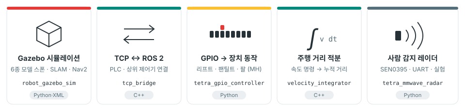

<div align="center">
  
  <h1>tetra_lab</h1>
  <p><b>TETRA 로봇의 시뮬레이션 · 외부 연동 · 실험 기능 모음</b></p>
  
  
  
  
</div>

> 전체 시스템은 [tetra_integration README](https://github.com/TETRA-ROBOT/tetra_integration#readme), ROS 패키지 지도는 [`ros/src` README](https://github.com/TETRA-ROBOT/tetra_integration/blob/main/ros/src/README.md) 를 보세요.

## 한눈에 보기

- 실 로봇 없이 TETRA 6종을 **Gazebo 에서 띄우고** SLAM·Nav2·웹 관제까지 확인합니다 (`robot_gazebo_sim`).
- PLC·상위 제어기 같은 **외부 장치와 TCP 로 데이터를 주고받습니다** (`tcp_bridge`).
- MH 의 GPIO 출력 신호로 **리프트·팬틸트·로봇 팔을 움직이는** 예전 방식 컨트롤러가 있습니다 (`tetra_gpio_controller`, 기본 꺼짐).
- 그 밖에 주행 거리 적분기와 실험용 사람 감지 레이더 드라이버가 들어 있습니다.

## 🚀 빠른 시작

1. 빌드된 워크스페이스를 불러옵니다.
   ```bash
   source /opt/ros/jazzy/setup.bash && source ~/tetra_integration/ros/install/setup.bash
   ```
2. 하고 싶은 일의 런치를 하나 고릅니다 (아래 [자주 하는 작업](#-자주-하는-작업)).
   ```bash
   ros2 launch robot_gazebo_sim full_sim.launch.py robot_model:=m navigation:=true
   ```
3. 결과를 토픽으로 확인합니다.
   ```bash
   ros2 topic hz /scan
   ```

> [!WARNING]
> 실 로봇이 돌고 있는 PC·네트워크에서 시뮬레이션을 띄우면 같은 `/cmd_vel`, `/scan` 토픽이 섞입니다.
> 먼저 `export ROS_DOMAIN_ID=<다른 번호>` 로 도메인을 나누세요.

## 📦 구성

| 패키지 | 하는 일 | 실행 파일 · 런치 | 언어 | 라이선스 |
|---|---|---|---|---|
| [`robot_gazebo_sim`](robot_gazebo_sim/README.md) | Gazebo Harmonic 시뮬레이션 (단일/다중 로봇, 충전 스테이션, SLAM·Nav2) | `full_sim`, `gazebo_sim`, `sim_bringup`, `sim_navigation`, `multi_robot_sim`, `rviz_sim`, `spawn_*` 런치 | Python · XML | MIT |
| `tcp_bridge` | 외부 TCP 장치 ↔ ROS 2 토픽 | `tcp_server_node`, `tcp_client_node` / `tcp_bridge_server`, `tcp_bridge_client` 런치 | C++ | Apache-2.0 |
| [`tetra_gpio_controller`](tetra_gpio_controller/README.md) | GPIO 출력 0→1 을 리프트·팬틸트·팔 명령으로 바꿈 | `gpio_controller_node` / `gpio_controller.launch.py` | Python | Apache-2.0 |
| `velocity_integrator` | `/cmd_vel_nav` 의 전진 속도를 적분해 누적 거리 발행 | `velocity_integrator_node` / `velocity_integrator.launch.py` | C++ | Apache-2.0 |
| [`tetra_mmwave_radar`](tetra_mmwave_radar/README.md) | (실험) DFRobot SEN0395 24 GHz 사람 감지 레이더 드라이버 | `mmwave_radar_node` / `mmwave_radar.launch.py` | Python | MIT |

## 🧭 자주 하는 작업

| 하고 싶은 일 | 명령 |
|---|---|
| 시뮬레이션 한 번에 띄우기 (Gazebo + 브링업 + RViz) | `ros2 launch robot_gazebo_sim full_sim.launch.py robot_model:=m` |
| 다른 모델로 띄우기 | `robot_model:=h` (m, h, edu, mh, s, sm) |
| 시뮬레이션에서 지도 만들면서 주행 (SLAM + Nav2) | `ros2 launch robot_gazebo_sim full_sim.launch.py navigation:=true slam:=true` |
| 저장된 지도로 자율주행 | `ros2 launch robot_gazebo_sim full_sim.launch.py navigation:=true` (지도는 `tetra_navigation2/maps/office.yaml`) |
| 로봇 두 대 띄우기 (기본 M + EDU) | `ros2 launch robot_gazebo_sim multi_robot_sim.launch.py` |
| 시뮬레이션 + 웹 관제까지 | 통합 레포의 `scripts/start_single_simulation.sh` (`full_sim.launch.py` 를 부름) |
| 외부 장치가 로봇에 접속해 데이터를 보내게 | `ros2 launch tcp_bridge tcp_bridge_server.launch.py` → `ros2 topic echo /from_ros1` |
| 로봇이 외부 서버에 접속해 센서 값을 받아 오게 | `ros2 run tcp_bridge tcp_client_node --ros-args -p server_ip:=192.168.0.50 -p server_port:=9000` |
| MH 에서 GPIO 출력으로 리프트·팬틸트·팔 움직이기 | `ros2 launch tetra_bringup tetra_bringup_mh.launch.py use_gpio_controller:=true` |
| 주행 거리 보기 | `ros2 launch velocity_integrator velocity_integrator.launch.py` → `ros2 topic echo /distance` |
| 사람 감지 레이더 켜기 | `ros2 launch tetra_mmwave_radar mmwave_radar.launch.py` → `ros2 topic echo /mmwave_radar/presence_changed` |

<details>
<summary>시뮬레이션 단계별로 띄우기 (예전 방식)</summary>

```bash
# 1. Gazebo 가상 월드 실행 및 로봇 스폰
ros2 launch robot_gazebo_sim gazebo_sim.launch.py

# 2. 시뮬레이션 Bringup (Robot State Publisher + EKF)
ros2 launch robot_gazebo_sim sim_bringup.launch.py

# 3. RViz2 시각화
ros2 launch robot_gazebo_sim rviz_sim.launch.py

# 4. 시뮬레이션 자율주행 (Navigation2). 기본 slam:=true (지도 없이 SLAM), 지도로 가려면 slam:=false map_name:=office.yaml
ros2 launch robot_gazebo_sim sim_navigation.launch.py
```

`full_sim.launch.py` 인자: `robot_model`(기본 m), `world_file`, `navigation`(false), `slam`(false, `navigation:=true` 일 때만 의미 있음), `rviz`(true), `use_sim_time`(true).
따로 띄우는 `sim_navigation.launch.py` 는 기본이 `slam:=true` 라서 지도로 주행하려면 `slam:=false map_name:=<파일>.yaml` 을 줍니다.
</details>

## 📡 인터페이스

코드(`src/*.cpp`, `*.py`)에서 직접 확인한 이름과 타입입니다. 이름이 `/` 로 시작하지 않는 것은 노드 네임스페이스 기준 상대 이름입니다 (기본 네임스페이스면 앞에 `/` 가 붙습니다).

### tcp_bridge

<p align="center"></p>

**① 서버 모드 `tcp_server_node`** — 로봇이 TCP **9000** 포트에서 기다리고, 외부 장치가 접속해 데이터를 보냅니다.

| 방향 | 이름 | 타입 | 내용 |
|---|---|---|---|
| 발행 | `from_ros1` | `std_msgs/String` | `read()` 한 번에 받은 바이트(최대 1024 B)를 그대로. 줄바꿈·길이 헤더 같은 구분은 하지 않습니다 |

- 포트는 코드에 고정(9000)이고 파라미터가 없습니다. 접속은 한 번에 하나씩 받고, 로봇은 답장을 보내지 않습니다.

**② 클라이언트 모드 `tcp_client_node`** — 로봇이 외부 TCP 서버에 접속해 **30 ms 마다** 요청 줄을 보내고, 받은 줄을 토픽으로 나눕니다.

| 파라미터 | 기본값 | 설명 |
|---|---|---|
| `server_ip` | `192.168.123.53` | 접속할 서버 주소 |
| `server_port` | `9000` | 접속할 서버 포트 |

| 방향 | 이름 | 타입 | 받은 줄의 칸 (`,` 로 나눔, 0부터) |
|---|---|---|---|
| 보냄 (TCP) | — | 텍스트 | `DS,2,1,STATUS,XX\n` 을 30 ms 마다 |
| 발행 | `cmd_vel_pi` | `geometry_msgs/Twist` | 3 → `linear.x` (`angular.z` 는 0) |
| 발행 | `sonic_1` ~ `sonic_4` | `std_msgs/Float64` | 4 ~ 7 |
| 발행 | `radar` | `std_msgs/Float64` | **7** (sonic_4 와 같은 칸) |
| 발행 | `lidar_1` | `std_msgs/Int32` | 8 |
| 발행 | `dir` | `std_msgs/Int32` | 9 |
| 발행 | `infrared_1` ~ `infrared_8` | `std_msgs/Float64` | 10 ~ 17 |
| 발행 | `from_ros1` | `std_msgs/String` | 줄 전체 |

- 받은 데이터는 `\n` 이 올 때까지 모았다가 한 줄씩 처리합니다. 연결이 끊기면 1초마다 다시 접속합니다.
- `cmd_vel_pi` 는 이름만 속도 명령이고 TETRA 브링업 어디에도 연결돼 있지 않습니다. 로봇을 움직이려면 직접 이어야 합니다.

### tetra_gpio_controller

<p align="center"></p>

| 방향 | 이름 | 타입 |
|---|---|---|
| 구독 | `gpio_status` | `interfaces/msg/Gpio` |
| 서비스 호출 | `conveyor_auto_move_cmd` | `interfaces/srv/ConveyorAutoMovement` (출력 0 → `start=0`, 출력 1 → `start=8`) |
| 서비스 호출 | `herkulex/set_angle` | `herkulex_driver/srv/SetAngle` (팬 = 서보 1, 틸트 = 서보 2) |
| 서비스 호출 | `power_outport_cmd` | `interfaces/srv/PowerSetOutport` (처리한 출력을 0 으로 되돌림) |
| 액션 호출 | `/joint_trajectory_controller/follow_joint_trajectory` | `control_msgs/action/FollowJointTrajectory` (관절 `base, shoulder, elbow, wrist1~3`, 6초) |

- 팬틸트는 예전 herkulex 패키지와 같은 움직임이 되도록 각도 부호를 뒤집고(예전 기어비 −1.0), playtime 100 을 1120 ms(×11.2 ms) 로 보냅니다.
- MH 브링업은 2026-11-24 부터 이 노드를 **기본으로 끕니다** (`use_gpio_controller:=false`). 켜면 웹 GPIO 창의 출력이 켜자마자 꺼지고, 웹의 팬틸트 범위(±80°/±30°)·팔 충돌 검사를 거치지 않습니다 (`tetra_config` `tetra_bringup_mh.launch.py` 주석).

### velocity_integrator

| 방향 | 이름 | 타입 | 내용 |
|---|---|---|---|
| 구독 | `/cmd_vel_nav` | `geometry_msgs/Twist` | `linear.x` 만 씀 |
| 발행 | `/distance` | `std_msgs/Float64` | 시작부터의 누적 거리(m), 사다리꼴 적분. 명령이 올 때마다 발행 |

- 실제 바퀴가 아니라 **Nav2 가 낸 속도 명령**을 적분합니다. 회전은 무시하고, 후진 명령이면 값이 줄어듭니다.

### tetra_mmwave_radar (네임스페이스 `/mmwave_radar`)

| 방향 | 이름 | 타입 | 내용 |
|---|---|---|---|
| 발행 | `presence` | `std_msgs/Bool` | 센서 프레임마다 |
| 발행 | `presence_changed` | `std_msgs/Bool` | 값이 바뀔 때만 (TRANSIENT_LOCAL) |
| 발행 | `/diagnostics` | `diagnostic_msgs/DiagnosticArray` | 포트·프레임 상태 |
| 서비스 | `apply_config`, `factory_reset`, `start`, `stop` | `std_srvs/Trigger` | `apply_config` 는 센서 플래시에 저장 |

파라미터와 배선은 [`tetra_mmwave_radar/README.md`](tetra_mmwave_radar/README.md).

### robot_gazebo_sim

`gazebo_sim.launch.py` 의 `ros_gz_bridge` 가 Gazebo → ROS 로 넘기는 토픽: `/tf`, `/tf_static`, `/odom`(← `/model/robot/odometry`), `/scan`, `/imu`, `/camera/image_raw`, `/camera/color/image_raw`, `/camera/depth/image_rect_raw`, `/joint_states`, `/clock`. `/cmd_vel` 은 양방향입니다.
실기 전원 보드 대신 `sim_power_docking_manager.py` 가 `tetra_battery`, `battery_voltage`, `docking_status`, `emg_state`, `servo_state` 등을 10 Hz 로 내고 `power_data_read_cmd`·`power_adc_read_cmd` 서비스를 받습니다.

## 📊 벤치마크

레포 문서에 날짜와 함께 남은 실측값만 모았습니다.

| 항목 | 값 | 출처 |
|---|---|---|
| SEN0395 레이더 프레임 주기 | 약 1 Hz | 실 센서, USB 포트 10.3, 2026-11-25 (`tetra_mmwave_radar/README.md`) |
| SEN0395 설정 서비스 한 번 | 4 ~ 5 초 | 명령 사이 1초 간격(벤더 측정값) 때문 (`tetra_mmwave_radar/README.md`) |
| Gazebo 시작 → 로봇 스폰 | 약 6 초 (서버 ~2 초, GUI ~3 초, 스폰 ~1 초) | Gazebo Harmonic 8.9.0, Ubuntu 24.04, 2025-10-01 (`robot_gazebo_sim/TEST_RESULTS.md`) |

`tcp_bridge`, `tetra_gpio_controller`, `velocity_integrator` 는 기록된 실측값이 없습니다.

## 🛠 문제 해결

<details>
<summary><code>tcp_server_node</code> 가 "Bind failed" 를 내고 아무것도 안 받음</summary>

9000 포트를 다른 프로세스가 쓰고 있습니다. `ss -ltnp | grep 9000` 으로 확인하세요. 포트는 코드에 고정이라 파라미터로 바꿀 수 없습니다.
</details>

<details>
<summary><code>tcp_client_node</code> 로그에 <code>Short packet</code></summary>

쉼표로 나눈 칸이 18개보다 적은 줄이 왔습니다. 그 줄은 `/from_ros1` 에 원문만 내고 나머지 토픽은 건너뜁니다 (5초에 한 번 로그). 예전에는 이런 줄에서 노드가 죽었습니다 (2026-11-26 고침). 서버가 늘 18칸 이상 보내는지 확인하세요.
</details>

<details>
<summary><code>/radar</code> 값이 <code>/sonic_4</code> 와 똑같음</summary>

코드가 두 토픽 모두 7번 칸을 읽습니다 (`tcp_client_node.cpp`). 레이더 값이 따로 있으면 코드를 고쳐야 합니다.
</details>

<details>
<summary>GPIO 컨트롤러를 켰더니 웹 GPIO 창의 출력이 켜자마자 꺼짐</summary>

정상 동작입니다. 이 노드는 0→1 을 명령으로 쓰고 곧바로 그 출력을 0 으로 되돌립니다. 출력을 일반 출력으로 쓰려면 `use_gpio_controller:=false`(MH 기본값)로 두세요.
</details>

<details>
<summary>팬틸트가 움직이지 않음 ("herkulex/set_angle 서비스를 찾을 수 없습니다")</summary>

`herkulex_driver` 가 떠 있어야 합니다. MH 브링업의 `use_herkulex`(기본 true)와 `herkulex_port`(기본 `/dev/ttyS2`)를 확인하세요. 예전 herkulex 패키지의 `PanMove_cmd`/`TiltMove_cmd` 는 더 이상 띄우지 않습니다.
</details>

<details>
<summary>시뮬레이션 문제 (Gazebo 가 안 뜸, IMU 없음 등)</summary>

[`robot_gazebo_sim/TROUBLESHOOTING.md`](robot_gazebo_sim/TROUBLESHOOTING.md), [`robot_gazebo_sim/IMU_ISSUE_NOTES.md`](robot_gazebo_sim/IMU_ISSUE_NOTES.md) 를 보세요. Gazebo IMU 가 안 나오면 `gazebo_sim.launch.py use_fake_imu:=true` 로 가짜 IMU 를 씁니다.
</details>

## 📚 더 보기

- [`CONTEXT.md`](CONTEXT.md) — AI 에이전트용 요약 (GPIO 매핑)
- [`robot_gazebo_sim/README.md`](robot_gazebo_sim/README.md) · [`CHANGELOG.md`](robot_gazebo_sim/CHANGELOG.md) · [`TEST_RESULTS.md`](robot_gazebo_sim/TEST_RESULTS.md)
- [`tetra_gpio_controller/README.md`](tetra_gpio_controller/README.md)
- [`tetra_mmwave_radar/README.md`](tetra_mmwave_radar/README.md)
- MH 브링업에서 GPIO 컨트롤러를 끈 이유: `tetra_config` 의 `tetra_bringup/launch/tetra_bringup_mh.launch.py`, `CONTEXT.md` 10번
